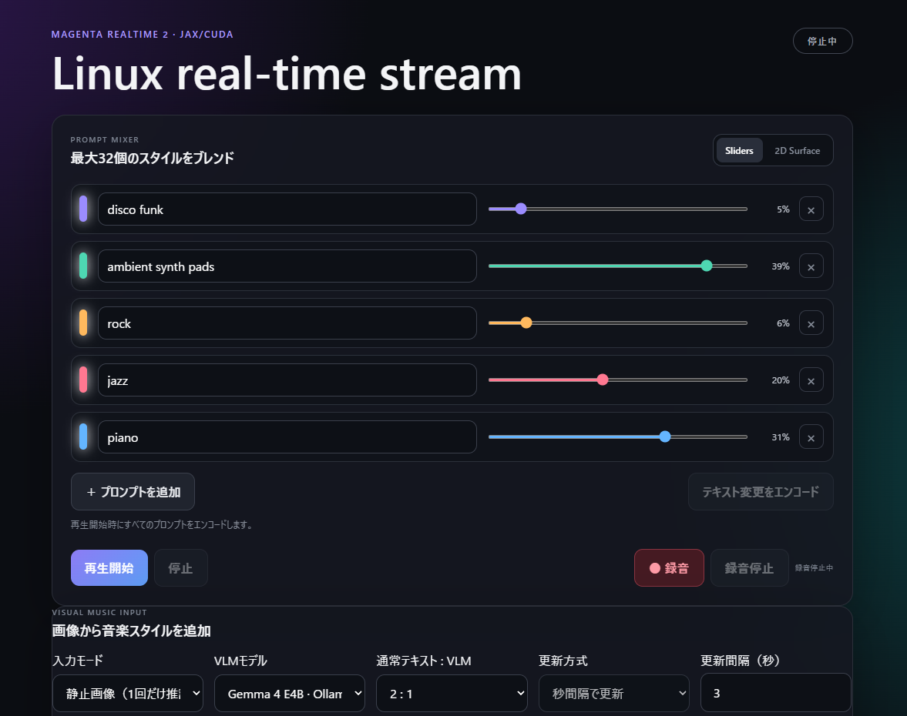
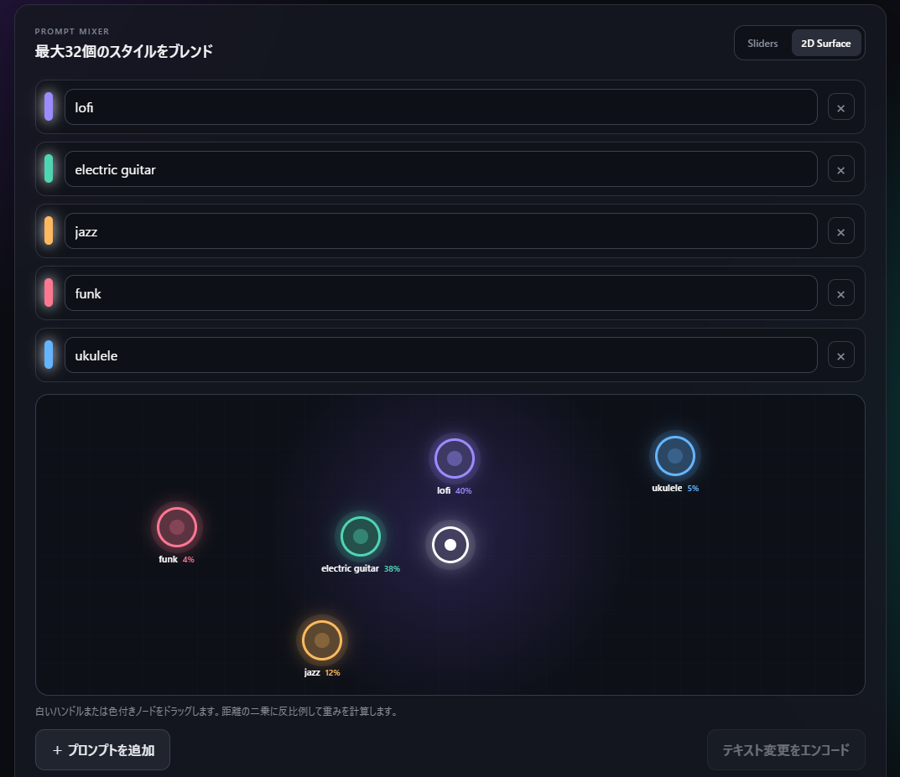
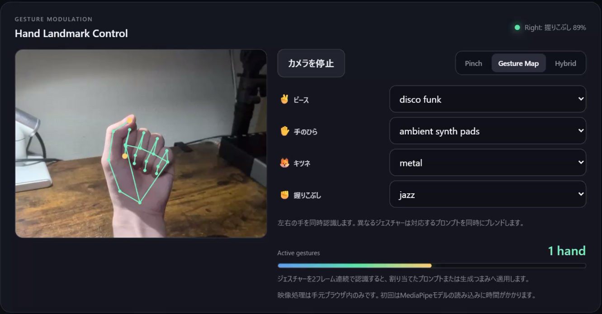
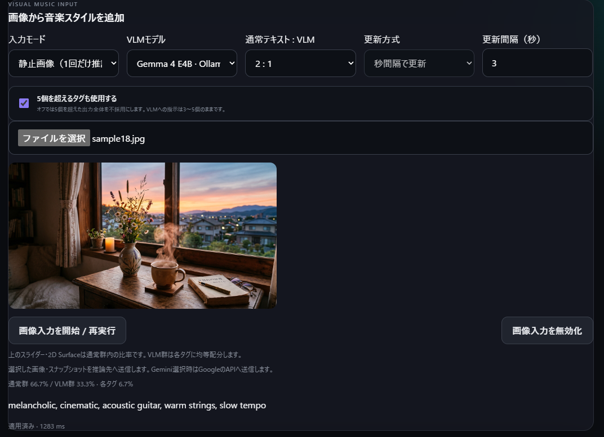

# Magenta RealTime 2 — Linux Web UI & Visual Music Control

> A research fork of [Google Magenta RealTime 2](https://github.com/magenta/magenta-realtime), extending the original model with **real-time music generation on Linux/NVIDIA GPUs**, a **browser-based control interface**, and **visual-to-music control using VLMs**.

This repository builds on the original MRT2 model and Python/JAX inference library. For the underlying model, official applications, model downloads, and general installation instructions, see the [upstream repository](https://github.com/magenta/magenta-realtime) and [official documentation](https://magenta.github.io/magenta-realtime/).

## Features Added in This Fork

- **Linux real-time streaming:** Stateful MRT2 generation and browser playback using JAX, FastAPI, and WebSockets (tested with `mrt2_small` on NVIDIA GPU hardware).
- **Interactive Web UI:** A 2D prompt surface, sliders for prompt weights and generation parameters, and live control without restarting the music stream.
- **Visual input:** Image and camera input for exploring visual-to-music interaction.
- **Three VLM backends:** Visual scenes are converted into music-related style descriptions (e.g., genre, mood, and instruments), then used as conditioning for MRT2:
  - **Gemini 3.5 Flash-Lite** via the Gemini API
  - **Gemma 4 E4B** via local Ollama (`gemma4:e4b`)
  - **Qwen 3.5 4B** via local Ollama (`qwen3.5:4b`)

## Web UI

Interactively change musical conditions through the 2D surface and sliders while listening to the generated audio. The camera can also provide visual input for VLM-based control.




## Visual-to-Music Control

The Web UI supports Gemini 3.5 Flash-Lite (API) and two local VLMs (Gemma 4 E4B and Qwen 3.5 4B through Ollama). An image or camera frame is interpreted as a music-style description and used to update the generation condition.



## Running the Linux Web UI

First, install the project's Python dependencies and download the MRT2 model/resources. Refer to the upstream [installation guide](https://github.com/magenta/magenta-realtime/blob/main/docs/installation.md) for general JAX/CUDA setup. Run the following commands from the repository root in the environment configured for this fork.

### Optional: Set up a VLM

- **Gemini 3.5 Flash-Lite:** Set the `GEMINI_API_KEY` environment variable in the shell before launching the Web UI server.
- **Gemma 4 E4B / Qwen 3.5 4B:** Install [Ollama](https://ollama.com/), download the required model (`gemma4:e4b` and/or `qwen3.5:4b`), and ensure that the Ollama server is running in a separate terminal or as a service.

### Launch the server

```bash
python scripts/jax_realtime_web.py \
  --model mrt2_small \
  --port 8001 \
  --ollama-host http://127.0.0.1:11434
```

Open **http://127.0.0.1:8001** in your browser.

The browser UI can be used without a VLM; Gemini credentials or Ollama are needed only when selecting their respective visual-control backends. 

## Upstream, License, and Citation

This is an independent research fork, **not an official Google Magenta release**. The original MRT2 model and upstream code were developed by Google Magenta / Google DeepMind. See the [official repository](https://github.com/magenta/magenta-realtime) for the original features and documentation.

The upstream source code is distributed under **Apache License 2.0**, and MRT2 model weights are distributed under **Creative Commons Attribution 4.0** (see the upstream [model card](https://github.com/magenta/magenta-realtime/blob/main/MODEL.md)). Preserve upstream copyright and license notices when redistributing modified files. See the repository's license files for the applicable terms.

For the original model and research, see the upstream citation instructions and the [Live Music Models technical report](https://arxiv.org/abs/2508.04651).
